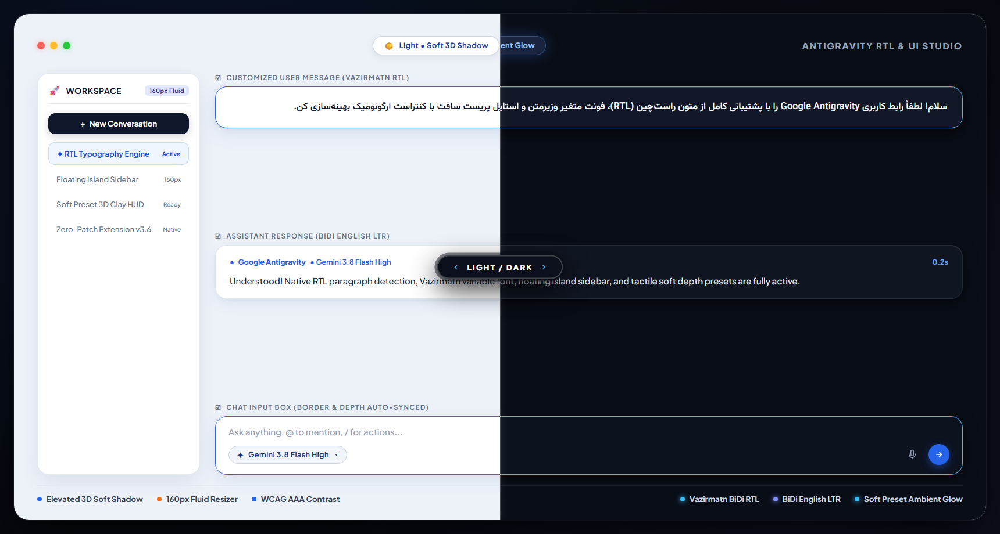
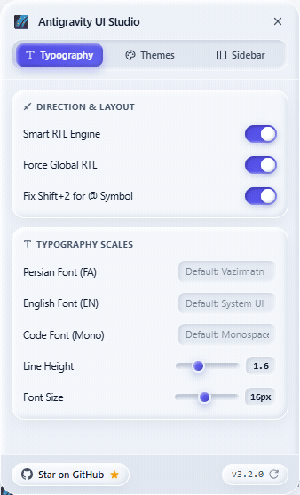
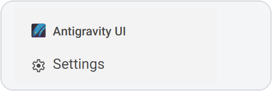
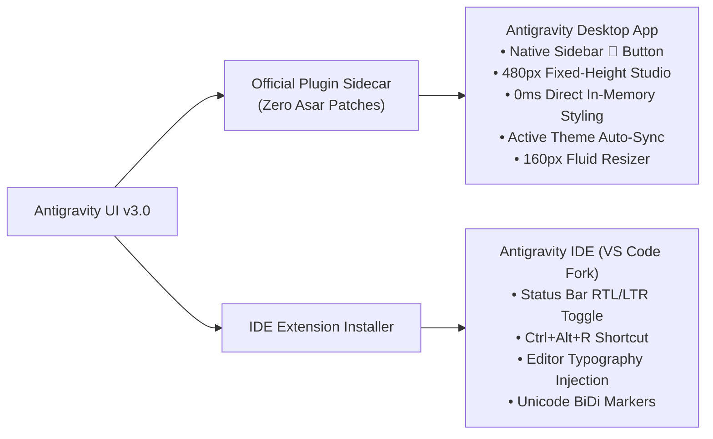

<div align="center">

# 🌌 Antigravity UI Studio

**The complete zero-patch UI enhancement, workspace ergonomics, and multilingual (RTL/BiDi) studio for Google Antigravity & Antigravity IDE.**

[](LICENSE)
[](https://www.npmjs.com/package/antigravity-ui)
[](https://open-vsx.org/extension/omid-io/antigravity-rtl)
[](https://github.com/omid-io/antigravity-ui/actions/workflows/ci.yml)
[](https://github.com/omid-io/antigravity-ui/releases/latest)
[](https://nodejs.org)
[](https://github.com/google/antigravity)

<p>
  <a href="#-quick-start"><b>🚀 Install</b></a> •
  <a href="https://github.com/omid-io/antigravity-ui/releases/latest"><b>📦 Latest Release (v3.0.0)</b></a> •
  <a href="https://www.npmjs.com/package/antigravity-ui"><b>🌐 npm Package</b></a> •
  <a href="https://open-vsx.org/extension/omid-io/antigravity-rtl"><b>🌌 Open VSX</b></a> •
  <a href="#-why-antigravity-ui-the-problems-we-solve">Why Antigravity UI?</a> •
  <a href="#-visual-tour">Visual Tour</a> •
  <a href="#-version-compatibility-matrix">Compatibility</a> •
  <a href="#-security-privacy--safety-guarantees">Security & Trust</a> •
  <a href="#-راهنمای-فارسی-persian-guide">راهنمای فارسی</a>
</p>

<br>



</div>

---

## 💡 Why Antigravity UI? (The Problems We Solve)

| Default Google Antigravity | With Antigravity UI Studio (v3.0 Native) |
| :--- | :--- |
| **Invasive Binary Patches:** Vulnerable to desktop app updates wiping custom changes. | **100% Zero-Patch Plugin:** Official Google Plugin architecture that safely survives app updates. |
| **Fixed 256px Sidebar:** Wastes ~100px of valuable screen space on laptop displays. | **Fluid 160px–420px Sidebar:** Smooth mouse dragging with anti-clipping text layout. |
| **Rigid Chat Styling:** Fixed colors with no control over message contrast or borders. | **Dual Dark Glow & Light 3D Studio:** Custom colors, borders, shadows & live sliders with 0ms lag. |
| **Manual Theme Synchronization:** User must manually align settings to light/dark. | **Active Theme Auto-Detection:** Automatically switches to active theme (Light/Dark) in real time. |
| **Fragmented Multilingual Text:** Persian/Arabic letters reversed, punctuation broken. | **Smart BiDi Engine:** Paragraph-level language detection + built-in Vazirmatn variable font. |
| **Disconnected IDE:** No unified typography between Chat and Code Editor. | **Companion IDE Extension:** Native VS Code status bar toggle and `Ctrl+Alt+R` hotkey. |

---

## 🌟 Visual Tour

<div align="center">
<table>
  <tr>
    <td align="center" width="46%" valign="top">
      <h4>🎛️ Dual-Theme UI Studio</h4>
      <p><sub>Independent Dark (Glow) & Light (3D Shadow) modes with smooth tab physics</sub></p>
      
    </td>
    <td align="center" width="54%" valign="top">
      <h4>📍 Activity Bar Docking & Compact Mode</h4>
      <p><sub>Docked above Settings with fluid mouse dragging down to 160px</sub></p>
      <br>
      
      <br><br>
      <div align="left">
        <ul>
          <li><b>Zero Clutter:</b> Docked inside the sidebar, no floating button obstruction</li>
          <li><b>Fluid 160px Dragging:</b> Natural mouse resize (160px–420px) breaking the 256px limit</li>
          <li><b>Anti-Clipping:</b> Left-pinned text alignment keeps labels fully readable</li>
          <li><b>Click-to-Toggle:</b> Opens on click; cleanly dismisses with <code>Esc</code> or outside click</li>
        </ul>
      </div>
    </td>
  </tr>
</table>
</div>

---

## ⚡ Dual-Engine Architecture (Zero-Patch Ecosystem)

**Antigravity UI** is engineered to provide a cohesive, unified workspace across your entire Google Antigravity workflow without touching Google's core binaries:



1. **Antigravity Desktop App (Native Plugin Engine):** Loads as an official Antigravity plugin. Injects the native 🌌 studio button directly into the chat sidebar, enables 0ms in-memory theme and font mutations, smart bidirectional text, and the fluid 160px sidebar resizer.
2. **Antigravity IDE (VS Code Fork):** Automatically detects `antigravity-ide` and installs the native companion extension, adding a status bar direction switch and `Ctrl+Alt+R` hotkey for code, markdown, and prompt editing.

---

## 🧩 Version Compatibility Matrix

Antigravity UI Studio is version-aware and continuously validated against upstream Google releases:

| Antigravity Version | Antigravity IDE | Antigravity UI Studio | Status | Architecture & Verification Notes |
| :--- | :--- | :--- | :--- | :--- |
| **Antigravity 2.17.x – 2.20.x+** | `1.107.0+` (Code-OSS) | `v3.0.0` | 🟢 **Verified & Tested** | 100% Zero-Patch Plugin + 480px Studio + VSIX Companion |
| **Antigravity 2.16.x** | `1.107.0+` | `v3.0.0` | 🟢 **Verified & Tested** | Official Plugin Sidecar Engine |
| **Antigravity 2.x** (Earlier builds) | `1.100.x+` | `v3.0.0` | 🟢 **Compatible** | Standard Electron / Plugin Sidecar |
| **Cross-Platform OS** | Windows, macOS, Linux | `v3.0.0` | 🟢 **CI-Verified** | Multi-OS verified & zero security leaks (Gitleaks passed) |

---

## ✨ Features

### 🎨 Dual-Theme UI & Styling Engine
- **Independent Theme Tabs**: Customize user message bubbles separately for **Dark Mode** (with vibrant Neon Glow) and **Light Mode** (with elevated 3D shadow).
- **Zero-Inversion Contrast (WCAG AAA)**: Text and labels stay crystal clear across all themes without washed-out labels or inverted colors.
- **Granular Visual Controls**: Custom background color, text color, border width, border color, and shadow intensity presets (`None`, `Soft`, `3D`, `Glow`).
- **Synchronized Chat Input**: Automatically harmonizes the active prompt input box border with your personalized bubble styling.
- **Decoupled Architecture**: Custom UI styling stays 100% active even when the RTL engine is toggled off (ideal for English-only developers who only want the UI perks!).

### 📐 Ergonomic Workspace & Compact Sidebar (160px)
- **Activity Sidebar Docking**: Integrates seamlessly right above the Settings gear icon, keeping the chat canvas clean.
- **Fluid Mouse Resizing**: Natural, smooth mouse dragging across the calibrated 160px–420px range.
- **Compact Sidebar (160px)**: Allows resizing down to 160px with left-pinned CSS rules that prevent text clipping on smaller laptop screens.
- **Click-to-Toggle**: Opens only on click and dismisses smoothly on outside click or the `Esc` key.

### 📝 Smart Multilingual Typography & BiDi Engine
- **Intelligent Auto-Direction**: Dynamically detects paragraph language, right-aligning Persian/Arabic while keeping English and code blocks LTR.
- **Force RTL Mode**: Option to align all content to the right when full RTL layout is preferred.
- **Built-in Vazirmatn Font**: Ships with the modern, high-legibility Vazirmatn Variable font out of the box.
- **Independent Font Families**: Configure separate fonts for RTL text, Latin text, and code blocks.
- **Typography Sliders**: Fine-tune line height and font size with live responsive sliders.
- **Persian Keyboard Optimization**: Automatically maps `Shift + 2` to type `@` instead of `٬` on Persian keyboard layouts.
- **Zero White-Screen Startup Guard**: Runs inside an isolated IIFE with safe lifecycle hooks to prevent Electron startup race conditions.

---

## 🚀 Quick Start

No repository cloning or manual file copying required. Simply run the command for your operating system:

### Windows
Open **PowerShell** as **Administrator** (Right-click -> Run as Administrator), then run:
```powershell
npx antigravity-ui
```
*(Legacy alias `npx antigravity-rtl` is also fully supported)*

### macOS
Ensure [Node.js](https://nodejs.org) is installed (e.g. `brew install node`). Run with `sudo`:
```bash
sudo npx antigravity-ui
```
> **macOS Note:** If you encounter a "Permission Denied" error with `sudo`, ensure your terminal app has **App Management** permission in `System Settings > Privacy & Security > App Management`.

### Linux
```bash
sudo npx antigravity-ui
```

### CLI Commands & Flags
- `update` or `--update`: Check the npm registry for new versions, automatically upgrade via npm, and synchronize desktop and IDE patches.
- `--restore`: Revert Antigravity Desktop and IDE to their factory state after verifying SHA-256 backup integrity.
- `--force`: (Optional) Force restore even if metadata is missing or hash mismatch is detected.
- `--devtools`: (Optional) Enable Chromium DevTools in the packaged desktop app for custom DOM debugging.

> [!TIP]
> **Automatic Update Notifications:** The CLI automatically checks the official npm registry in the background during normal runs and alerts you with a clean update box if a newer release is published.
>
> **Antigravity Upstream Updates:** Updating Antigravity Desktop will reset patched files. Simply re-run `npx antigravity-ui` (or `antigravity-ui update`) after any official app update to restore your custom studio. The patcher will automatically refresh its pristine backup to the new version.

---

## 🛡️ Security, Privacy & Safety Guarantees

Because Antigravity UI interacts with application packaging files, we hold transparency and data safety to the highest standard:

- 🔒 **Zero Telemetry or Data Exfiltration:** The patcher never transmits code, chats, credentials, or workspace data to any server. A lightweight 24-hour cached version check queries only the official public npm registry for release updates with an ultra-fast non-blocking timeout.
- 🛡️ **Version-Aware Safety Backup & SHA-256 Verification:** Automatically preserves an untouched backup (`app.asar.bak`) with full 64-character SHA-256 checksum and metadata (`app.asar.meta.json`) whenever a fresh official Google release is detected before patching. During `--restore`, the patcher calculates the backup hash and blocks the operation if any corruption or tampering is detected.
- 💡 **Legacy Backup Semantics:** For backups created by older releases prior to metadata introduction, the restore command executes under a safe, unverified fallback without blocking your workflow, whereas all backups created by modern releases enforce strict cryptographic integrity.
- ⚡ **One-Command Full Revert:** Run `npx antigravity-ui --restore` at any moment to cleanly return desktop files and the IDE extension to 100% factory state (overrideable with `--force` if needed).
- 🎯 **Transparent Modifications:** Applies localized UI/DOM styling, font injection, and workspace ergonomics to the packaged desktop app and companion IDE extension; never reads, stores, or alters your API keys, credentials, or workspace projects.
- 🛠️ **Opt-In DevTools:** Chromium DevTools inspection is disabled by default and only unlocked if you explicitly pass the `--devtools` flag.

---

## 🔄 Uninstall / Restore

To revert Antigravity Desktop and Antigravity IDE to their factory state at any time:

```bash
npx antigravity-ui --restore
```
*(On macOS/Linux, prepend `sudo`)*

---

## 🏛️ Attribution & Credits

- Based on initial proof-of-concept by **Mohammad Mahdi Naderi** (`mmnaderi/antigravity-rtl`).
- Re-engineered, decoupled, and maintained by **Omid Zaferi** (`omid-io/antigravity-ui`) as an independent full-suite UI studio with IDE integration and laptop ergonomics.

---

<div dir="rtl">

# 🇮🇷 راهنمای فارسی (Persian Guide)

<div align="center">

## سوئیت جامع ارتقای رابط کاربری، سایدبار ارگونومیک و پشتیبانی هوشمند فارسی در Antigravity

**شخصی سازی پیشرفته رابط کاربری، کاهش عرض سایدبار تا ۱۶۰ پیکسل، پشتیبانی کامل از فونت وزیرمتن و هماهنگی همزمان با ادیتور کد Antigravity IDE**

<br>


</div>

---

### 💡 چرا Antigravity UI؟ (مشکلاتی که حل می کنیم)

| پیش فرض Google Antigravity | با Antigravity UI Studio |
| :--- | :--- |
| **سایدبار ثابت ۲۵۶ پیکسل:** هدر رفتن فضای ارزشمند مانیتور به خصوص در لپ تاپ ها. | **سایدبار منعطف ۱۶۰ تا ۴۲۰ پیکسل:** درگ کاملاً روان موس با چیدمان ضد بریدگی متن. |
| **ظاهر ثابت و یکنواخت چت:** عدم امکان شخصی سازی رنگ یا خوانایی حباب پیام ها. | **استودیو تم دارک نئونی و لایت ۳ بعدی:** کنترل اسلایدرهای فونت، حاشیه و سایه. |
| **به هم ریختگی متون چندزبانه:** برعکس شدن حروف فارسی/عربی و پرش علائم نگارشی. | **موتور هوشمند BiDi:** تشخیص خودکار زبان پاراگراف + فونت توکار وزیرمتن. |
| **ناهماهنگی ادیتور و چت:** عدم وجود فونت و جهت مناسب در ادیتور کد Antigravity IDE. | **افزونه اختصاصی ادیتور:** سوییچ جهت در Status Bar و میانبر `Ctrl+Alt+R`. |

---

### 🧩 جدول سازگاری نسخه ها (Compatibility Matrix)

| نسخه Antigravity | ادیتور Antigravity IDE | نسخه Antigravity UI | وضعیت | توضیحات فنی |
| :--- | :--- | :--- | :---: | :--- |
| **نسخه های 2.17.x (جدیدترین)** | `1.107.0` به بالا | `v2.0.9` | 🟢 **تست شده و فعال** | سایدبار ۱۶۰px و نصب خودکار VSIX |
| **نسخه های 2.16.x** | سری 1.107.x | `v2.0.9` | 🟢 **تست شده و فعال** | تزریق استاندارد با انکر لودینگ |
| **سایر بیلدهای 2.x** | سری 1.100.x به بالا | `v2.0.9` | 🟡 **سازگار** | ساختار سازگار Asar و هسته الکترون |
| **نسخه های 1.x** | سری 1.x | `v2.0.9` | 🟡 **سازگار قبلی** | پچ پایه با قابلیت بازگردانی |
| **سیستم عامل ها** | ویندوز، مک، لینوکس | `v2.0.9` | 🟢 **تایید شده در CI** | اجرای ماتریس ۹ تایی ابری (نود ۱۸، ۲۰ و ۲۲ روی اوبونتو، مک و ویندوز) |

---

### 🌟 قابلیت های کلیدی (نسخه ۳.۰ نیتِیو)

#### ۱. معماری ۱۰۰٪ بدون پچ (Zero-Patch Architecture)
* **پلاگین رسمی Antigravity:** بدون هیچ گونه دستکاری یا پچ کردن فایلهای باینری هسته گوگل (app.asar)؛ افزونه به صورت پلاگین رسمی اجرا شده و با به روزرسانی های نرم افزار پاک نمی شود.
* **دکمه یکپارچه در سایدبار 🌌:** اضافه شدن دکمه استودیو مستقیماً در سایدبار اصلی بالای دکمه Settings با طراحی کاملاً بومی.
* **ادیتور کد Antigravity IDE:** شناسایی خودکار ادیتور کد و نصب افزونه اختصاصی با کلید میانبر `Ctrl+Alt+R` و دکمه تغییر جهت در نوار وضعیت (Status Bar).

#### ۲. استودیو شخصی سازی و انطباق خودکار تم (Dynamic Theme Auto-Sync)
* **تشخیص هوشمند تم فعال:** استودیو به صورت خودکار تم جاری پنجره (روشن یا تاریک) را شناسایی کرده و تب مربوطه را باز می کند.
* **تغییرات زنده بدون تاخیر (0ms In-Memory Mutation):** کلیه تغییرات رنگ، سایه و کادرها در لحظه در حافظه مرورگر اعمال می شوند بدون نیاز به ریستارت یا درخواست شبکه.
* **ارتفاع ثابت و پایدار ۴۸۰ پیکسل:** فریم پنجره پاپ آپ در تمامی تب ها روی ۴۸۰ پیکسل ثابت مانده و حین تغییر تب هیچ پرشی ندارد.
* **کنتراست استاندارد WCAG AAA:** تضمین خوانایی ۱۰۰٪ متون و لیبل ها در هر دو تم بدون هیچ گونه وارونگی یا محو شدگی.
* **فوتر حمایتی با ستاره گیت هاب:** دکمه تعاملی برای ستاره دادن و حمایت از توسعه پروژه.

#### ۳. سایدبار ارگونومیک فشرده (Compact 160px)
* **درگ آزاد و روان موس بین ۱۶۰ تا ۴۲۰ پیکسل:** شکستن محدودیت ۲۵۶ پیکسلی پیش فرض نرم افزار و صرفه جویی در فضای مانیتور لپ تاپ ها.
* **بدون بریدگی متون:** چیدمان پین شده به چپ برای حفظ خوانایی منوها حتی در عرض ۱۶۰ پیکسل.

#### ۴. تایپوگرافی کریستالی و فونت وزیرمتن
* **رندرینگ ساب پیکسل بدون تاری:** حذف فیلترهای بلور و ترنسفرم های کسری جهت دستیابی به حداکثر شفافیت ClearType.
* **راست چین خودکار پاراگراف ها:** تشخیص هوشمند زبان هر پاراگراف؛ متن فارسی راست چین و کدهای انگلیسی چپ چین می مانند.
* **فونت توکار Vazirmatn Variable:** بالاترین سطح وضوح و خوانایی با وزن ۴۰۰ متعادل.
* **حل مشکل کیبورد فارسی:** نگاشت خودکار کلید ترکیبی `Shift + 2` برای تایپ کاراکتر `@` در چیدمان فارسی.

---

### 🛡️ تضمین های امنیتی و حفظ حریم خصوصی

- 🔒 **عدم ارسال تله متری و حفظ کامل داده ها:** پچر هرگز کدها، گفتگوها، توکن ها یا اطلاعات کاری شما را به هیچ سروری ارسال نمی کند. صرفاً یک بررسی سبک و کش شده ۲۴ ساعته نسخه پکیج مستقیماً با رجیستری عمومی npm برای اطلاع رسانی آپدیت ها با تایم اوت بسیار سریع و بدون معطلی انجام می پذیرد.
- 🛡️ **بکاپ هوشمند آگاه از نسخه و اعتبارسنجی SHA-256:** ایجاد خودکار نسخه پشتیبان دست نخورده (`app.asar.bak`) با ثبت هش کامل ۶۴ کاراکتری SHA-256 و متادیتا (`app.asar.meta.json`) با هر بار به روزرسانی رسمی گوگل؛ حین دستور بازگردانی (`--restore`)، سلامت فایل بکاپ اعتبارسنجی شده و در صورت هرگونه نقص یا دستکاری، عملیات مسدود می شود.
- 💡 **سمانتیک بکاپ های قدیمی:** بکاپ های مربوط به نسخه های پیشین (که فاقد متادیتا هستند) حین بازگردانی به صورت خودکار و سازگار (Graceful Fallback) بازیابی می شوند تا کاربر دچار وقفه کاری نشود؛ در حالی که بکاپ های نسخه های جدید منحصراً با شرط تطابق ۱۰۰٪ اثر انگشت رمزنگاری بازیابی می گردند.
- ⚡ **بازگردانی ۱۰۰٪ با یک دستور:** قابلیت بازگشت کامل به حالت کارخانه در هر لحظه با اجرای `npx antigravity-ui --restore` (و در صورت نیاز اضطراری با فلگ `--force`).
- 🎯 **تغییرات شفاف و بدون مداخله در اسرار:** صرفاً استایل های فرانت اند، فونت وزیرمتن و ارگونومی سایدبار اعمال شده و ابزار هیچ گونه دسترسی یا تغییری در کلیدهای API، توکن ها و سورس کدهای شما ندارد.
- 🛠️ **حفظ امنیت:** ابزار DevTools به صورت پیش فرض خاموش است و صرفاً در صورت ارسال فلگ اختیاری `--devtools` برای برنامه نویسان فعال می شود.

---

### 🚀 نحوه نصب و اجرا

ترمینال سیستم عامل خود را باز کرده و دستور زیر را اجرا نمایید:

#### در ویندوز (Windows)
برنامه **PowerShell** را با راست کلیک و انتخاب **Run as Administrator** اجرا کرده و دستور زیر را بزنید:
```powershell
npx antigravity-ui
```

#### در مک (macOS)
```bash
sudo npx antigravity-ui
```

#### در لینوکس (Linux)
```bash
sudo npx antigravity-ui
```

### 💻 دستورات و فلگ های خط فرمان (CLI Commands & Flags)
- `update` یا `--update`: بررسی رجیستری رسمی npm، ارتقای خودکار به آخرین نسخه و همگام سازی مجدد پچ های دسکتاپ و IDE.
- `--restore`: بازگردانی فایل های دسکتاپ و افزونه IDE به وضعیت خام کارخانه پس از راستی آزمایی رمزنگاری هش SHA-256 نسخه پشتیبان.
- `--force`: (اختیاری) اجبار به بازگردانی حتی در صورت عدم وجود فایل متادیتا یا هشدار عدم تطابق هش.
- `--devtools`: (اختیاری) فعال سازی ابزار توسعه کرومیوم (DevTools) در برنامه دسکتاپ برای دیباگ و شخصی سازی عمیق المان های DOM.

---

### 🔄 بازگردانی به حالت اولیه کارخانه (Uninstall)

جهت بازگردانی سریع کلیه تغییرات Desktop و افزونه IDE به وضعیت پیش فرض:
```powershell
npx antigravity-ui --restore
```

---

### 📄 لایسنس و حقوق توسعه
این پروژه تحت مجوز متن باز **MIT** منتشر شده و توسط **امید ظفری** توسعه یافته است.

</div>
