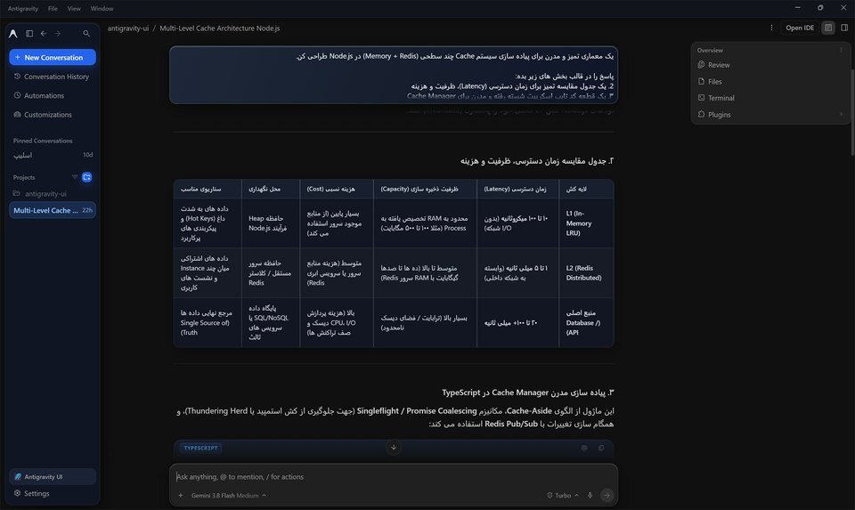
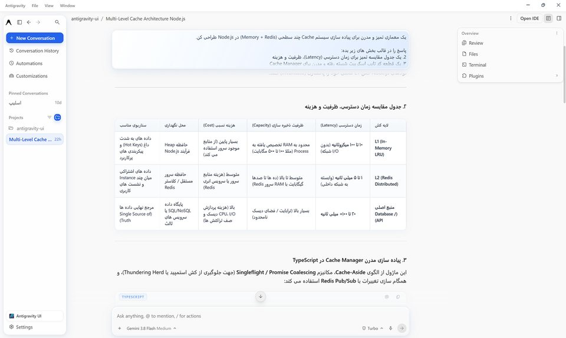
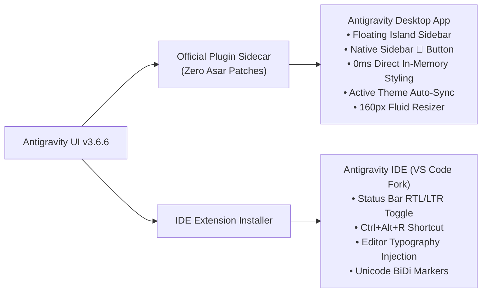

<div align="center">

# 🌌 Antigravity UI & RTL Studio

**The complete zero-patch UI enhancement, native RTL & Persian/Arabic (راست چین) typography engine, workspace ergonomics, and tactile theme studio for Google Antigravity & Antigravity IDE.**

[](LICENSE)
[](https://www.npmjs.com/package/antigravity-ui)
[](https://open-vsx.org/extension/omid-io/antigravity-rtl)
[-10b981.svg)](#-persian--arabic-rtl-engine)
[](#-راهنمای-فارسی-persian-guide)
[](https://github.com/omid-io/antigravity-ui/actions/workflows/ci.yml)
[](https://github.com/omid-io/antigravity-ui/releases/latest)
[](https://nodejs.org)
[](https://github.com/google/antigravity)

<p>
  <a href="#-quick-start"><b>🚀 Install</b></a> •
  <a href="https://github.com/omid-io/antigravity-ui/releases/latest"><b>📦 Latest Release (v3.6.6)</b></a> •
  <a href="https://www.npmjs.com/package/antigravity-ui"><b>🌐 npm Package</b></a> •
  <a href="https://open-vsx.org/extension/omid-io/antigravity-rtl"><b>🌌 Open VSX</b></a> •
  <a href="#-why-antigravity-ui-the-problems-we-solve">Why Antigravity UI?</a> •
  <a href="#-visual-tour">Visual Tour</a> •
  <a href="#-version-compatibility-matrix">Compatibility</a> •
  <a href="#-security-privacy--safety-guarantees">Security & Trust</a> •
  <a href="#-راهنمای-فارسی-persian-guide">راهنمای فارسی</a>
</p>

```bash
# Instant launch with zero permanent patches (survives all Google Antigravity updates)
npx antigravity-ui
```

<br>


</div>

---

## 💡 Why Antigravity UI? (The Problems We Solve)

| Default Google Antigravity | With Antigravity UI Studio (v3.6.6 Native) |
| :--- | :--- |
| **Invasive Binary Patches:** Vulnerable to desktop app updates wiping custom changes. | **100% Zero-Patch Plugin:** Official Google Plugin architecture that safely survives app updates. |
| **Fixed 256px Docked Sidebar:** Clunky vertical borders and wasted ~100px screen real estate. | **Floating Island Sidebar & 160px Fluid Resizer:** Detached frosted glass canvas with zero divider borders. |
| **Rigid Chat Styling:** Fixed colors with no control over message contrast or borders. | **Dual Dark Glow & Light 3D Studio:** Custom colors, borders, shadows & live sliders with 0ms lag. |
| **Crushed Titles & Overlapping Action Buttons:** Titles truncate into 2-letter fragments and collide with `+` / `...` buttons. | **Zero-Collision Action Boxes & Fluid Titles:** Solid, borderless action badges with dynamic hover masking. |
| **Manual Theme Synchronization:** User must manually align settings to light/dark. | **Active Theme Auto-Detection:** Automatically switches to active theme (Light/Dark) in real time. |
| **Fragmented Multilingual RTL & Inverted Text:** Persian/Arabic letters reversed, inverted brackets `(abc)`, broken punctuation, reverse ellipsis (`...پ`). | **Smart BiDi Plaintext & RTL Engine:** 100% native Right-to-Left (راست چین) rendering, natural paragraph language detection, inverted bracket auto-correction, and built-in Vazirmatn variable font. |
| **Disconnected IDE:** No unified typography between Chat and Code Editor. | **Companion IDE Extension:** Native VS Code status bar toggle and `Ctrl+Alt+R` hotkey. |

---

## 🌟 Visual Tour

<div align="center">
<table>
  <tr>
    <td align="center" width="46%" valign="top">
      <h4>🎛️ Live Extension Studio & Dual-Theme Engine</h4>
      <p><sub>All 3 tabs (Typography, Chat, Sidebar) captured live with active Dark Theme toggle</sub></p>
      
    </td>
    <td align="center" width="54%" valign="top">
      <h4>📍 Activity Bar Docking & Compact Mode</h4>
      <p><sub>Docked above Settings with fluid mouse dragging down to 160px</sub></p>
      <br>
      
      <br><br>
      <div align="left">
        <ul>
          <li><b>Floating Island Canvas:</b> Elegant detached sidebar with rounded corners and invisible divider line</li>
          <li><b>Fluid 160px Dragging:</b> Natural mouse resize (160px–420px) breaking the default 256px limit</li>
          <li><b>Zero-Collision Action Boxes:</b> Harmonized hover badges cleanly masking timestamps without text collision</li>
          <li><b>Live Dark & Light Auto-Sync:</b> Instant adaptation to active Light/Dark themes with zero lag</li>
          <li><b>Native BiDi & RTL Support:</b> Full paragraph language detection for Persian, Arabic, and mixed codebases</li>
        </ul>
      </div>
    </td>
  </tr>
</table>
</div>

<br>

### 📸 Full Application Showcase (Click to Open High-Resolution in New Tab)

<div align="center">
<table>
  <tr>
    <td align="center" width="50%" valign="top">
      <h4>🌙 Dark Mode • Ambient Neon Glow & RTL</h4>
      <p><sub>Vazirmatn BiDi typography, floating island sidebar, and soft glow chat bubbles</sub></p>
      <a href="screenshots/social-media/dark.jpg" target="_blank" rel="noopener noreferrer">
        
      </a>
      <p><sub>🔍 <i>Click image to view full 1920×1146 resolution</i></sub></p>
    </td>
    <td align="center" width="50%" valign="top">
      <h4>☀️ Light Mode • Tactile 3D Soft Shadow & BiDi</h4>
      <p><sub>High contrast WCAG AAA readability, clean floating canvas, and 3D depth</sub></p>
      <a href="screenshots/social-media/light.jpg" target="_blank" rel="noopener noreferrer">
        
      </a>
      <p><sub>🔍 <i>Click image to view full 1920×1146 resolution</i></sub></p>
    </td>
  </tr>
</table>
</div>

---

## ⚡ Dual-Engine Architecture (Zero-Patch Ecosystem)

**Antigravity UI** is engineered to provide a cohesive, unified workspace across your entire Google Antigravity workflow without touching Google's core binaries:



1. **Antigravity Desktop App (Native Plugin Engine):** Loads as an official Antigravity plugin. Injects the native 🌌 studio button directly into the chat sidebar, enables 0ms in-memory theme and font mutations, smart bidirectional text, floating island sidebar architecture, and the fluid 160px sidebar resizer.
2. **Antigravity IDE (VS Code Fork):** Automatically detects `antigravity-ide` and installs the native companion extension, adding a status bar direction switch and `Ctrl+Alt+R` hotkey for code, markdown, and prompt editing.

---

## 🧩 Version Compatibility Matrix

Antigravity UI Studio is version-aware and continuously validated against upstream Google releases:

| Antigravity Version | Antigravity IDE | Antigravity UI Studio | Status | Architecture & Verification Notes |
| :--- | :--- | :--- | :--- | :--- |
| **Antigravity 2.17.x – 2.20.x+** | `1.107.0+` (Code-OSS) | `v3.6.6` | 🟢 **Verified & Tested** | 100% Zero-Patch Plugin + Floating Island Sidebar + Pure CSS 160px Resizer + BiDi Plaintext |
| **Antigravity 2.16.x** | `1.107.0+` | `v3.6.6` | 🟢 **Verified & Tested** | Official Plugin Sidecar Engine |
| **Antigravity 2.x** (Earlier builds) | `1.100.x+` | `v3.6.6` | 🟢 **Compatible** | Standard Electron / Plugin Sidecar |
| **Cross-Platform OS** | Windows, macOS, Linux | `v3.6.6` | 🟢 **CI-Verified** | Multi-OS verified & zero security leaks (Gitleaks passed) |

---

## ✨ Features

### 🏝️ Floating Island Sidebar & Workspace Ergonomics
- **Floating Island Canvas**: Detaches the sidebar from window edges with custom elevations (`Soft`, `3D`, `Clay`, `Glow`, `Minimal`), rounded corners, and zero border clipping.
- **Invisible Resizer Divider**: Eliminates distracting vertical sash divider lines between the sidebar and chat canvas while preserving smooth mouse dragging.
- **Pure CSS Compact Sidebar (160px)**: Seamlessly resize the sidebar down to 160px with fluid scaling for the logo and top buttons.
- **Zero-Collision Solid Action Badges**: Folders and conversation rows feature solid, borderless action boxes with matching hover backgrounds (`#eaf1fb` light / `#1c273a` dark), completely eliminating foreign grey blurred masks and preventing text collision with action buttons.
- **100% Switch Isolation & Clean Reset**: Toggling the Floating Island switch off cleanly restores factory docked metrics without leaving residual padding or style anomalies.

### 🎨 Dual-Theme UI & Styling Engine
- **Independent Theme Tabs**: Customize user message bubbles separately for **Dark Mode** (with vibrant Neon Glow) and **Light Mode** (with elevated 3D shadow and tactile Clay presets).
- **Zero-Inversion Contrast (WCAG AAA)**: Text and labels stay crystal clear across all themes without washed-out labels or inverted colors.
- **Granular Visual Controls**: Custom background color, text color, border width, border color, and shadow intensity presets (`None`, `Soft`, `3D`, `Clay`, `Glow`).
- **Synchronized Chat Input**: Automatically harmonizes the active prompt input box border with your personalized bubble styling.
- **Autonomous 1-Click In-Place Updates**: Instant background updates streamed directly into the sidecar environment without opening external browser tabs.
- **Decoupled Architecture**: Custom UI styling stays 100% active even when the RTL engine is toggled off.

### 📝 Smart Multilingual Typography & BiDi Plaintext Engine
- **Intelligent Auto-Direction**: Dynamically detects paragraph language, right-aligning Persian/Arabic while keeping English and code blocks LTR.
- **BiDi Plaintext Direction**: Fixes reversed ellipsis (`...پ`) on truncated titles, preserving the natural start of RTL words.

> [!TIP]
> **Visual BiDi Difference (Before vs. After):**
> - **Without Antigravity UI:** `...متن تستی با پرانتز معکوس (abc) و سه نقطه برعکس` (reversed punctuation, inverted brackets `)(`, flipped ellipsis).
> - **With Antigravity UI:** `متن تستی با پرانتز صحیح (abc) و سه نقطه استاندارد...` (100% natural right-to-left flow, crisp Vazirmatn variable font).
- **Interactive Multi-Choice Question BiDi Support (`ask_question`)**: Automatically detects Persian prompts in interactive dialogs, right-aligns option choices, positions numbered badges on the right, and isolates mixed direction prefixes like `(Recommended)`.
- **Force RTL Mode**: Option to align all content to the right when full RTL layout is preferred.
- **Built-in Vazirmatn Font**: Ships with the modern, high-legibility Vazirmatn Variable font out of the box.
- **Independent Font Families**: Configure separate fonts for RTL text, Latin text, and code blocks.
- **Typography Sliders**: Fine-tune line height and font size with live responsive sliders.
- **Persian Keyboard Optimization**: Automatically maps `Shift + 2` to type `@` instead of `٬` on Persian keyboard layouts.

---

## 🚀 Quick Start

No repository cloning or manual file copying required. Simply run the command for your operating system:

### Windows
Open **PowerShell** as **Administrator** (Right-click -> Run as Administrator), then run:
```powershell
npx antigravity-ui
```
*(Legacy alias `npx antigravity-rtl` is also fully supported)*

### macOS
Ensure [Node.js](https://nodejs.org) is installed (e.g. `brew install node`). Run with `sudo`:
```bash
sudo npx antigravity-ui
```

### Linux
```bash
sudo npx antigravity-ui
```

### ⌨️ Keyboard Shortcuts & Gestures

| Shortcut / Gesture | Action | Target / Scope |
| :--- | :--- | :--- |
| `Ctrl+Alt+R` / `Cmd+Alt+R` | Toggle Real-time RTL / LTR Direction | Antigravity IDE & Code Editor |
| `Esc` or Click Outside | Instantly Dismiss UI Studio Panel | Antigravity Desktop App |
| `Drag Divider` | Fluid Sidebar Resize (160px – 420px) | Left Workspace Pane |
| `Ctrl+Shift+P` → `Antigravity RTL` | Open Command Palette RTL Actions | Antigravity IDE |

---

### CLI Commands & Flags
- `update` or `--update`: Check the npm registry for new versions, automatically upgrade via npm, and synchronize desktop and IDE patches.
- `--restore`: Revert Antigravity Desktop and IDE to their factory state after verifying SHA-256 backup integrity.
- `--force`: (Optional) Force restore even if metadata is missing or hash mismatch is detected.
- `--devtools`: (Optional) Enable Chromium DevTools in the packaged desktop app for custom DOM debugging.

---

## 🛡️ Security, Privacy & Safety Guarantees

Because Antigravity UI interacts with application packaging files, we hold transparency and data safety to the highest standard:

- 🔒 **Zero Telemetry or Data Exfiltration:** The patcher never transmits code, chats, credentials, or workspace data to any server. A lightweight 24-hour cached version check queries only the official public npm registry for release updates with an ultra-fast non-blocking timeout.
- 🛡️ **Version-Aware Safety Backup & SHA-256 Verification:** Automatically preserves an untouched backup (`app.asar.bak`) with full 64-character SHA-256 checksum and metadata (`app.asar.meta.json`) whenever a fresh official Google release is detected before patching. During `--restore`, the patcher calculates the backup hash and blocks the operation if any corruption or tampering is detected.
- ⚡ **One-Command Full Revert:** Run `npx antigravity-ui --restore` at any moment to cleanly return desktop files and the IDE extension to 100% factory state.
- 🎯 **Transparent Modifications:** Applies localized UI/DOM styling, font injection, and workspace ergonomics; never reads, stores, or alters your API keys, credentials, or workspace projects.

---

## ❓ Frequently Asked Questions (FAQ)

<details>
<summary><b>1. Will this survive official Google Antigravity desktop updates?</b></summary>
<br>
<b>Yes, 100%.</b> Unlike legacy binary asar patchers that get wiped out on every desktop app update, Antigravity UI Studio operates exclusively on Google's official <b>Plugin Sidecar Architecture</b>. Your themes, typography preferences, and sidebar settings safely survive all desktop application updates without needing to re-patch.
</details>

<details>
<summary><b>2. Does it work completely offline?</b></summary>
<br>
<b>Yes.</b> All variable fonts (including Vazirmatn Variable), icons, and stylesheets are bundled 100% locally within the package. There are zero external CDN requests, telemetry trackers, or external network dependencies.
</details>

<details>
<summary><b>3. Can I use custom Persian or Arabic fonts?</b></summary>
<br>
<b>Yes.</b> Inside the UI Studio popup under the <b>Typography</b> tab, you can enter any installed font family name (such as <i>Vazirmatn</i>, <i>Noto Sans Arabic</i>, <i>Rubik</i>, <i>Markazi Text</i>, or your custom fonts). It applies instantly with 0ms lag.
</details>

<details>
<summary><b>4. How do I install the companion IDE extension directly?</b></summary>
<br>
Run the following command in your terminal:
```bash
code --install-extension omid-io.antigravity-rtl
```
Or search for <code>Antigravity RTL</code> in the VS Code / Open VSX Extension Marketplace.
</details>

---

## 🔄 Uninstall / Restore

To revert Antigravity Desktop and Antigravity IDE to their factory state at any time:

```bash
npx antigravity-ui --restore
```
*(On macOS/Linux, prepend `sudo`)*

---

## 🏛️ Attribution & Credits

- Based on initial proof-of-concept by **Mohammad Mahdi Naderi** (`mmnaderi/antigravity-rtl`).
- Re-engineered, decoupled, and maintained by **Omid Zaferi** (`omid-io/antigravity-ui`) as an independent full-suite UI studio with IDE integration and laptop ergonomics.

---

<div dir="rtl">

# 🇮🇷 راهنمای فارسی (Persian Guide)

<div align="center">

## سوئیت جامع ارتقای رابط کاربری، پشتیبانی کامل راست چین (RTL) و تایپوگرافی فارسی در Antigravity

**حل ریشه ای برعکس شدن متون فارسی و عربی (راستچین / راست چین)، پرانتزها و علائم نگارشی، فونت متغیر وزیرمتن، سایدبار جزیره ای شناور ۱۶۰ پیکسل و هماهنگی کامل دارک و لایت**

<br>


</div>

---

### 💡 چرا Antigravity UI؟ (مشکلاتی که حل می کنیم)

| پیش فرض Google Antigravity | با Antigravity UI Studio (نسخه ۳.۶.۶) |
| :--- | :--- |
| **سایدبار متصل و ثابت ۲۵۶ پیکسل:** خط مرزی اضافی و هدر رفتن فضای مانیتور لپ تاپ ها. | **سایدبار شناور جزیره ای ۱۶۰ تا ۴۲۰ پیکسل:** طراحی مینیمال شیشه ای بدون خط مرزی مزاحم و درگ کاملا روان موس. |
| **تداخل دکمه ها با عناوین:** افتادن دکمه های سه نقطه و + روی نام فولدرها و کلمات چت. | **باکس های اکشن یکدست بدون تداخل:** باکس های همرنگ با هاور، بدون خط بردر و با پوشش ۱۰۰٪ زمان چت. |
| **ترانکیت شدید عناوین چت:** کوتاه شدن کلمات به ۲ حرف حین فشرده سازی سایدبار. | **عناوین پویا و هوشمند:** اختصاص حداکثر عرض در حالت عادی و فشرده سازی هوشمند صرفا در لحظه هاور. |
| **ترانکیت معکوس فارسی:** نمایش ناقص انتهای کلمات به صورت معکوس (`...پ`). | **موتور هوشمند BiDi Plaintext:** نمایش صحیح کلمات فارسی از ابتدای کلمه با جهت یابی طبیعی. |
| **ظاهر ثابت چت:** عدم امکان شخصی سازی رنگ یا خوانایی حباب پیام ها. | **استودیو تم دارک نئونی و لایت ۳ بعدی:** کنترل اسلایدرهای فونت، حاشیه و سایه بدون تاخیر. |
| **عدم وجود فونت مناسب در ادیتور:** | **افزونه اختصاصی ادیتور:** سوییچ جهت در Status Bar و میانبر `Ctrl+Alt+R`. |

---

### 🧩 جدول سازگاری نسخه ها (Compatibility Matrix)

| نسخه Antigravity | ادیتور Antigravity IDE | نسخه Antigravity UI | وضعیت | توضیحات فنی |
| :--- | :--- | :--- | :---: | :--- |
| **نسخه های 2.17.x تا 2.20.x+ (جدیدترین)** | `1.107.0` به بالا | `v3.6.6` | 🟢 **تست شده و فعال** | سایدبار شناور جزیره ای، سایدبار ۱۶۰px، باکس های اکشن هماهنگ و BiDi |
| **نسخه های 2.16.x** | سری 1.107.x | `v3.6.6` | 🟢 **تست شده و فعال** | موتور سایدکار نیتِیو بدون پچ باینری |
| **سایر بیلدهای 2.x** | سری 1.100.x به بالا | `v3.6.6` | 🟢 **سازگار** | ساختار سازگار Asar و پلاگین رسمی |
| **سیستم عامل ها** | ویندوز، مک، لینوکس | `v3.6.6` | 🟢 **تایید شده در CI** | اعتبارسنجی شده در تمامی پلتفرم ها بدون نشت اطلاعات (Gitleaks Passed) |

---

### 🌟 قابلیت های کلیدی نسخه ۳.۶.۶

#### ۱. سایدبار جزیره ای شناور (Floating Island Sidebar)
* **طراحی شناور و مدرن:** سایدبار با فواصل متقارن از لبه های پنجره جدا شده و گوشه های گرد با افکت های بصری (`Soft` شیشه ای، `3D` برجسته، `Clay` حجمی و `Glow` نئونی) به خود می گیرد.
* **حذف کامل خط مرزی ساش:** خط عمودی جداکننده میان سایدبار و محیط گفتگو کاملا حذف و شفاف شده تا محیط کار خلوت و یکپارچه باشد.
* **اتصال کامل به کلید سوییچ:** تمام استایل های سایدبار به کلید Floating Island متصل هستند و در صورت خاموش کردن، سایدبار در لحظه به ساختار پیش فرض کارخانه بازمی گردد.

#### ۲. باکس های اکشن یکدست و بدون تداخل (Zero-Collision Action Boxes)
* **حذف بلر خاکستری و ترنزیشن های ناهمخوان:** دکمه های سه نقطه، پین و آرشیو درون یک باکس یکدست همرنگ با هاور ردیف قرار می گیرند.
* **پوشش کامل زمان چت:** باکس ها مستقیما به لبه راست ردیف می چسبند و مانع بیرون زدن ثانیه ها و دقایق چت در لحظه هاور می شوند.
* **رفع تداخل دکمه های فولدر:** دکمه های `+` و سه نقطه فولدر پروژه نیز درون باکس هماهنگ قرار گرفته و با اعمال فواصل مناسب، هرگز روی عنوان فولدر نمی افتند.

#### ۳. عناوین پویا در سایدبار فشرده (Fluid Titles)
* در حالت عادی (عدم هاور)، عناوین چت ها و فولدرها حداکثر فضای ردیف را به خود اختصاص داده و دیگر کلمات به ۲ حرف ترانکیت نمی شوند.
* به لطف `unicode-bidi: plaintext`، متون فارسی به صورت طبیعی از ابتدای کلمه نمایش داده شده و از انتهای کلمه ترانکیت معکوس نمی گردند.

#### ۴. موتور هوشمند راست چین و رفع معکوس شدن پرانتزها (Smart BiDi RTL Engine)
* تشخیص خودکار زبان پاراگراف ها و راست چین کردن استاندارد متون فارسی و عربی همزمان با چپ چین ماندن کدهای انگلیسی.
* حل قطعی مشکل برعکس شدن پرانتزها، براکت ها مانند `(abc)` و علامت های نگارشی بدون نیاز به دستکاری ساختار کد.
* تعبیه فونت متغیر وزیرمتن (Vazirmatn) با خوانایی فوق العاده و پشتیبانی کامل از گلیف های فارسی و عربی.

#### ۵. پریست های عمق سه بعدی و سافت (Tactile 3D & Soft Depth Presets)
* انتخاب سریع استایل های بصری شامل Soft Ambient (سایه نرم ارگونومیک)، Elevated 3D، Claymorphism و Neon Glow.
* تنظیم هماهنگ و بلادرنگ کادر دور ورودی متن چت با استایل حباب کاربر.

#### ۶. کلیدهای میانبر سریع و ژست های حرکتی
* `Ctrl+Alt+R` (یا `Cmd+Alt+R` در مک): تغییر آنی جهت متن بین راست چین و چپ چین در ادیتور کد و پنجره چت
* `Esc` (یا کلیک در فضای خالی): بستن آنی پنجره استودیو
* درگ موس روی خط جداکننده: کاهش عرض سایدبار از ۲۲۰ تا ۱۶۰ پیکسل بدون محدودیت

---

### 🚀 نحوه نصب و اجرا

ترمینال سیستم عامل خود را باز کرده و دستور زیر را اجرا نمایید:

#### در ویندوز (Windows)
برنامه **PowerShell** را با راست کلیک و انتخاب **Run as Administrator** اجرا کرده و دستور زیر را بزنید:
```powershell
npx antigravity-ui
```

#### در مک (macOS)
```bash
sudo npx antigravity-ui
```

#### در لینوکس (Linux)
```bash
sudo npx antigravity-ui
```

### 💻 دستورات و فلگ های خط فرمان (CLI Commands & Flags)
- `update` یا `--update`: بررسی رجیستری رسمی npm، ارتقای خودکار به آخرین نسخه و همگام سازی مجدد پچ های دسکتاپ و IDE.
- `--restore`: بازگردانی فایل های دسکتاپ و افزونه IDE به وضعیت خام کارخانه پس از راستی آزمایی رمزنگاری هش SHA-256 نسخه پشتیبان.
- `--force`: (اختیاری) اجبار به بازگردانی حتی در صورت عدم وجود فایل متادیتا یا هشدار عدم تطابق هش.
- `--devtools`: (اختیاری) فعال سازی ابزار توسعه کرومیوم (DevTools) در برنامه دسکتاپ برای دیباگ و شخصی سازی عمیق المان های DOM.

---

### 🔄 بازگردانی به حالت اولیه کارخانه (Uninstall)

جهت بازگردانی سریع کلیه تغییرات Desktop و افزونه IDE به وضعیت پیش فرض:
```powershell
npx antigravity-ui --restore
```

---

### 📄 لایسنس و حقوق توسعه
این پروژه تحت مجوز متن باز **MIT** منتشر شده و توسط **امید ظفری** توسعه یافته است.

</div>
